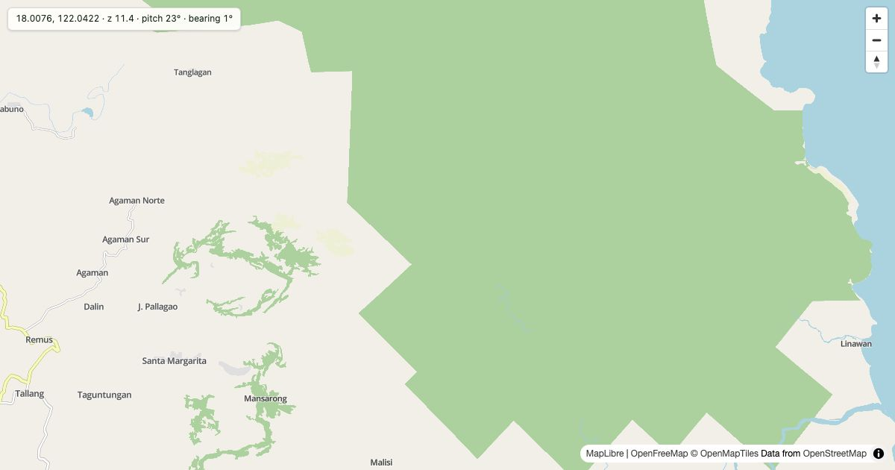

# Basemap

> A self-hosted MapLibre GL style: the OpenMapTiles "OSM" vector style (v3.16) repointed at OpenFreeMap's worldwide vector tiles, with all fonts, sprites and icons served from GitHub Pages.

> [!NOTE]
> **Canonical host is www.ogis.org** — never use the org's legacy `*.github.io` Pages host. It 301-redirects to www.ogis.org, and the redirect hop breaks CORS in browsers, so every published URL points at www.ogis.org directly.

## Screenshot



> [!NOTE]
> Regenerated on every build — each `./scripts/build.sh` run renders a fresh random map (a random land point anywhere on Earth, quality-gated). To make a new one without the full map build, run `npm run site:build` first, then `npm run screenshot:random`.

## Overview

Basemap vendors the OpenMapTiles "OSM" vector style (v3.16 — the vector equivalent of the official openstreetmap-carto raster) and repoints it at OpenFreeMap's worldwide, free OpenMapTiles-schema vector tiles. All fonts, sprites and icons are self-hosted on GitHub Pages with open CORS, so anyone can use the style or its assets directly.

The repository is one root Nuxt site. Its only consumer-facing route is `/` — a full-screen MapLibre basemap at London Paddington (zoom 17) with a compact Open GIS overlay. The overlay carries the live camera readout, an **Inspect POIs** toggle and an **Export palette** button. Inspecting a POI opens an inspector with its icon, name, class/subclass, layer and palette role; editing the role colour recolours every icon in that role live on the map. **Export palette** downloads the current colours as `palette.json`. Browser edits are live only — to make them permanent, update the root [`palette.json`](palette.json) and rebuild. The style itself is built from vendored upstream sources with the same docker tooling OpenMapTiles uses (`openmaptiles-tools:7.2`), then rewritten to point at the published URLs. See [docs/2.build.md](docs/2.build.md) for the pipeline.

## Live URLs

| Asset   | URL                                                        |
| ------- | ---------------------------------------------------------- |
| Demo    | https://www.ogis.org/basemap/                              |
| Style   | https://www.ogis.org/basemap/style.json                    |
| Glyphs  | https://www.ogis.org/basemap/fonts/{fontstack}/{range}.pbf |
| Sprite  | https://www.ogis.org/basemap/sprite                        |
| Icons   | https://www.ogis.org/basemap/icons/{name}.svg              |
| Tiles   | https://tiles.openfreemap.org/planet                       |

## Usage

### MapLibre GL JS

```js
const map = new maplibregl.Map({
  container: "map",
  style: "https://www.ogis.org/basemap/style.json",
});
```

### Assets in a custom style

```json
{
  "version": 8,
  "sources": {
    "openmaptiles": {
      "type": "vector",
      "url": "https://tiles.openfreemap.org/planet"
    }
  },
  "glyphs": "https://www.ogis.org/basemap/fonts/{fontstack}/{range}.pbf",
  "sprite": "https://www.ogis.org/basemap/sprite"
}
```

### Remixing

Edit the vendored layer styles under `vendor/openmaptiles/layers/*/style.json` for style changes. Palette target colours are edited in `palette.json`; `./scripts/build.sh` stages recoloured icons in `build/icons` and then rebuilds the style, sprite and published icons:

```bash
./scripts/build.sh
```

To preview palette changes without a build, open the [demo](https://www.ogis.org/basemap/), turn on **Inspect POIs**, click a POI and change its role colour. Every icon in the role updates live; **Export palette** downloads a `palette.json` containing the current colours. Those browser edits are live only, so copy them into the root `palette.json` before running the full build.

To rebuild only the deployable site after app or palette-data changes that do not need new map artefacts, run `npm run site:build`; use `npm run dev` for a live preview at <http://127.0.0.1:11100/basemap/>. See [docs/3.remixing.md](docs/3.remixing.md), [docs/5.palette.md](docs/5.palette.md) and [docs/6.site.md](docs/6.site.md).

### Screenshots

Render the homepage to a PNG with Playwright after building the site:

```bash
npm run site:build
npm run screenshot -- --lat 51.5074 --lng -0.1278 --zoom 12 --pitch 45 --rotation 20 --width 1200 --height 630 --out london.png
```

`npm run screenshot:random` renders a random land point anywhere on Earth (quality-gated) to `screenshots/random.jpg`. Full flag reference and the harness URL API: [docs/4.screenshots.md](docs/4.screenshots.md).

## Attribution and Licences

Attribution is baked into the published style: **OpenFreeMap · © OpenMapTiles · Data from OpenStreetMap**. Keep it when remixing.

| Project                                                                    | Component                 | Licence      |
| -------------------------------------------------------------------------- | ------------------------- | ------------ |
| [OpenStreetMap](https://www.openstreetmap.org)                             | Tile data                 | ODbL-1.0     |
| [OpenFreeMap](https://openfreemap.org)                                     | Tile service              | MIT          |
| [OpenMapTiles](https://openmaptiles.org)                                   | Style code                | BSD-3-Clause |
| [OpenMapTiles](https://openmaptiles.org)                                   | Design and cartography    | CC-BY-4.0    |
| [openstreetmap-carto](https://github.com/gravitystorm/openstreetmap-carto) | Design & icon inspiration | CC0-1.0      |
| [Open Sans](https://fonts.google.com/specimen/Open+Sans)                   | Font                      | Apache-2.0   |
| [Noto Sans](https://fonts.google.com/noto/specimen/Noto+Sans)              | Font                      | OFL-1.1      |
| [MapLibre GL JS](https://maplibre.org)                                     | Demo renderer             | BSD-3-Clause |

## Further Reading

- [Getting started](docs/1.start.md)
- [Build pipeline](docs/2.build.md)
- [Remixing the style](docs/3.remixing.md)
- [Screenshot pipeline](docs/4.screenshots.md)
- [Icon palette](docs/5.palette.md)
- [Site and palette inspector](docs/6.site.md)
- [Full docs index](docs/README.md)
