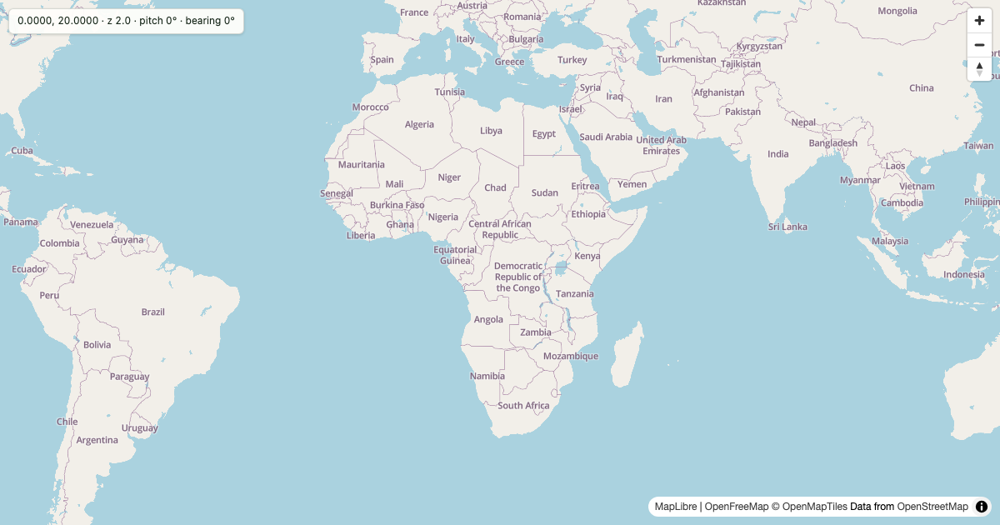
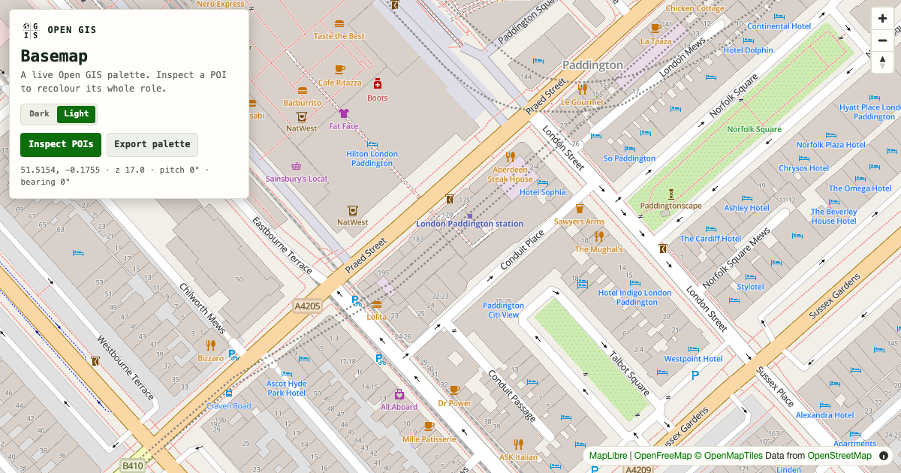

# Basemap

> A dark-first, self-hosted MapLibre GL basemap: the OpenMapTiles "OSM" vector style repointed at OpenFreeMap's worldwide vector tiles, with dark and light styles, sprites, icons and shared fonts served from GitHub Pages.

> [!IMPORTANT]
> **Both styles ship together** — the live site serves Basemap Dark as the default at `/basemap/style.json` and Basemap Light at `/basemap/style-light.json`, with both sprite sets, `icons/`, `icons-light/` and the shared `fonts/`. A rebuild must deploy the whole `.output/public`; the Pages workflow does this.

> [!NOTE]
> **Canonical host is www.ogis.org** — never use the org's legacy `*.github.io` Pages host. It 301-redirects to www.ogis.org, and the redirect hop breaks CORS in browsers, so every published URL points at www.ogis.org directly.

## Screenshot

| Dark (default) | Light |
| --- | --- |
|  |  |

> [!NOTE]
> Regenerated by the Playwright end-to-end suite. Run `npm run site:build` first, then `npm run test:e2e`.

## Overview

Basemap vendors the OpenMapTiles "OSM" vector style (the vector equivalent of the official openstreetmap-carto raster) and repoints it at OpenFreeMap's worldwide, free OpenMapTiles-schema vector tiles. It publishes two styles from one upstream recompose: **Basemap Dark** at the root `style.json` (the default) and **Basemap Light** at `style-light.json`. Light is a cartographic no-op of the raw recompose; dark starts from that light clone and applies a strict, ordered theme derived from the Open GIS branding palette. Each style has its own sprite set and icon tree, while the merged font stacks are shared.

The repository is one root Nuxt site. Its only consumer-facing route is `/` — a full-screen MapLibre basemap at London Paddington (zoom 17) with a compact Open GIS overlay. The site opens dark by default and carries a **Dark / Light** toggle that swaps the site tokens and the map style together, preserving the camera. The overlay also carries the live camera readout, an **Inspect POIs** toggle and an **Export palette** button. Inspecting a POI opens an inspector with its icon, name, class/subclass, layer and palette role; editing the role colour recolours every icon in that role live on the map. The inspector edits the active theme's palette, and **Export palette** downloads its current colours as `palette.json`. Browser edits are live only — to make them permanent, update the appropriate palette source and rebuild.

The map artefacts are built from vendored upstream sources with the same docker tooling OpenMapTiles uses (`openmaptiles-tools:7.2`), then rewritten to point at the published URLs. See [docs/2.build.md](docs/2.build.md) for the pipeline and [docs/7.themes.md](docs/7.themes.md) for the theme system.

## Live URLs

| Asset | URL |
| --- | --- |
| Demo | https://www.ogis.org/basemap/ |
| Dark style (default) | https://www.ogis.org/basemap/style.json |
| Light style | https://www.ogis.org/basemap/style-light.json |
| Glyphs (shared) | https://www.ogis.org/basemap/fonts/{fontstack}/{range}.pbf |
| Dark sprite | https://www.ogis.org/basemap/sprite |
| Light sprite | https://www.ogis.org/basemap/sprite-light |
| Dark icons | https://www.ogis.org/basemap/icons/{name}.svg |
| Light icons | https://www.ogis.org/basemap/icons-light/{name}.svg |
| Tiles | https://tiles.openfreemap.org/planet |

The live origin serves Basemap Dark as the default at `/basemap/style.json` and Basemap Light at `/basemap/style-light.json`. The light sprite (`/basemap/sprite-light`) and icon tree (`/basemap/icons-light/`) are live, and both styles share the glyphs under `/basemap/fonts/`.

## Usage

### Dark (default)

```js
const map = new maplibregl.Map({
  container: "map",
  style: "https://www.ogis.org/basemap/style.json",
});
```

### Light

```js
// Light
const map = new maplibregl.Map({
  container: "map",
  style: "https://www.ogis.org/basemap/style-light.json",
});
```

### Assets in a custom style

```json
{
  "version": 8,
  "sources": {
    "openmaptiles": {
      "type": "vector",
      "url": "https://tiles.openfreemap.org/planet"
    }
  },
  "glyphs": "https://www.ogis.org/basemap/fonts/{fontstack}/{range}.pbf",
  "sprite": "https://www.ogis.org/basemap/sprite"
}
```

Use `https://www.ogis.org/basemap/sprite-light` for the light sprite set.

## Building and remixing

The build stages both icon palettes, runs one Docker recompose, builds four sprites, generates both styles with [`scripts/style.js`](scripts/style.js), publishes both styles and icon trees, merges the font stacks referenced by either style, and assembles the site:

```bash
./scripts/build.sh
```

- **Map theme** — [`themes/dark/theme.json`](themes/dark/theme.json) holds the ordered dark colour rules and tokens; the engine lives in [`scripts/lib/theme.js`](scripts/lib/theme.js) and [`scripts/lib/colour.js`](scripts/lib/colour.js). Light deliberately leaves the upstream layer tree untouched. See [themes/README.md](themes/README.md) for the schema.
- **Icon palettes** — the root [`palette.json`](palette.json) is the light identity palette; [`themes/dark/palette.json`](themes/dark/palette.json) is the contrast-tuned dark palette. They recolour the primary fill of selected POI SVGs before the sprites are built.
- **Vendored style** — edit the layer styles under `vendor/openmaptiles/layers/*/style.json` for cartographic changes. The mirror is generated, so reapply local edits after `npm run upstream:sync`.

> [!NOTE]
> `vendor/openmaptiles/` is a pristine mirror of upstream `master`; `npm run upstream:sync` replaces it, `npm run upstream:verify` checks it offline and `npm run upstream:check` compares the locked commit with upstream. Provenance is in [`vendor/openmaptiles.lock.json`](vendor/openmaptiles.lock.json); see [vendor/README.md](vendor/README.md) for the mirrored paths. Syncing source does not rebuild the published styles — run `./scripts/build.sh` afterwards. Both workflows run `npm run upstream:verify` after `npm test`.

To preview palette changes without a build, open the [demo](https://www.ogis.org/basemap/) or use a local build, choose **Dark** or **Light**, turn on **Inspect POIs**, click a POI and change its role colour. Every icon in the role updates live; **Export palette** downloads a `palette.json` for the active palette. Copy a light export into the root `palette.json` or a dark export into `themes/dark/palette.json` before running the full build.

To rebuild only the deployable site after app or palette-data changes that do not need new map artefacts, run `npm run site:build`; use `npm run dev` for a live preview at <http://127.0.0.1:11100/basemap/>. See [docs/3.remixing.md](docs/3.remixing.md), [docs/5.palette.md](docs/5.palette.md) and [docs/6.site.md](docs/6.site.md).

### Screenshots

Render the homepage to a PNG with Playwright after building the site:

```bash
npm run site:build
npm run screenshot -- --lat 51.5074 --lng -0.1278 --zoom 12 --pitch 45 --rotation 20 --width 1200 --height 630 --out london.png
```

Pass `--theme light` for the light style and site palette. Full flag reference and the harness URL API: [docs/4.screenshots.md](docs/4.screenshots.md).

## Attribution and Licences

Attribution is baked into both published styles: **OpenFreeMap · © OpenMapTiles · Data from OpenStreetMap**. Keep it when remixing. The dark map theme and dark POI icon palette derive from the Open GIS branding palette and design tokens; the site design tokens adapt the same material.

| Project | Component | Licence |
| --- | --- | --- |
| [OpenStreetMap](https://www.openstreetmap.org) | Tile data | ODbL-1.0 |
| [OpenFreeMap](https://openfreemap.org) | Tile service | MIT |
| [OpenMapTiles](https://openmaptiles.org) | Style code | BSD-3-Clause |
| [OpenMapTiles](https://openmaptiles.org) | Design and cartography | CC-BY-4.0 |
| [openstreetmap-carto](https://github.com/gravitystorm/openstreetmap-carto) | Design & icon inspiration | CC0-1.0 |
| [Open GIS branding](https://github.com/OpenGIS/branding) | Palette, design tokens and dark theme material | MIT |
| [Open Sans](https://fonts.google.com/specimen/Open+Sans) | Font | Apache-2.0 |
| [Noto Sans](https://fonts.google.com/noto/specimen/Noto+Sans) | Font | OFL-1.1 |
| [MapLibre GL JS](https://maplibre.org) | Demo renderer | BSD-3-Clause |

## Further Reading

- [Getting started](docs/1.start.md)
- [Build pipeline](docs/2.build.md)
- [Remixing the style](docs/3.remixing.md)
- [Screenshot pipeline](docs/4.screenshots.md)
- [Icon palette](docs/5.palette.md)
- [Site and palette inspector](docs/6.site.md)
- [Theme system](docs/7.themes.md)
- [Theme engine and schema reference](themes/README.md)
- [Full docs index](docs/README.md)
